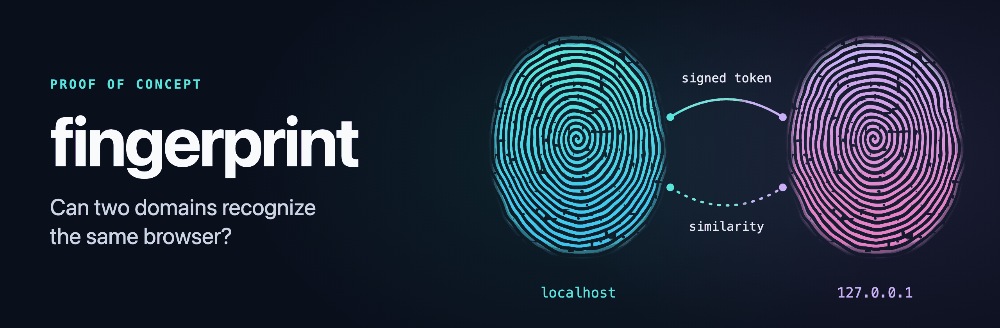

# fingerprint

A proof of concept that tests whether a website can recognize the same browser on a second domain.

Two demo shops run on one server and compare two ways of linking visits:

| Method | How it links visits | What you get |
|---|---|---|
| **Deterministic** | A signed, single-use token in the link between domains, or the same e-mail address on an order | A confirmed link |
| **Probabilistic** | A browser fingerprint of 23 signals, compared by weight, with detection of noise that browsers add on purpose | A similarity score |

The `/lab` page shows both methods side by side and measures how often the fingerprint finds the right visitor when the real answer is already known from a token or an order.

## Quick start

You need Node.js 26 or newer, which runs the server's TypeScript directly and includes SQLite. There are no runtime dependencies.

```bash
npm install
npm start
```

| URL | What it is |
|---|---|
| http://localhost:8080 | Shop A |
| http://127.0.0.1:8080 | Shop B |
| `/lab` on either one | Comparisons, candidates, identity graph, metrics |

No setup is needed for the two domains. Browsers treat `localhost` and `127.0.0.1` as different sites, with separate cookies and, in Brave, a separate noise seed.

## Try it

1. On Shop A, click **I agree**. A table of signals appears.
2. Click **Shop B - link with token** and give consent on Shop B too. You can see whether the token was accepted and which fingerprint from Shop A is closest.
3. Repeat in Safari, Firefox and Brave, including private mode. The **Same browser on two domains** section in `/lab` shows which signals change between domains.
4. Go to Shop B with **Shop B - plain link**. Without a token, only fingerprint matching is left.
5. Place a test order with the same e-mail address in two browsers. Both visits join one person in the identity graph.
6. Run `npm run report` to print the metrics in the terminal.

## How it works

**Handoff token.** The link to the other domain carries a token signed with HMAC-SHA-256. It is valid for 2 minutes, works once, and only on the domain it was issued for. The page removes it from the address bar on load, so it cannot leak through a copied link.

**Fingerprint comparison.** Each signal has a weight. The score is the matched weight divided by the weight that could be compared, so noised or missing signals are left out. A match counts as confident at a score of at least 90% with a compared weight of at least 20.

**Identity graph.** Only tokens and orders connect visits. A fingerprint match never joins two identities. It is only scored against the graph, which is how `/lab` can tell whether it was right.

## Configuration

| Variable | Default | Description |
|---|---|---|
| `PORT` | `8080` | Server port |
| `HOST` | `127.0.0.1` | Listen address; use `0.0.0.0` to test from a phone on the same network |
| `SITE_A_ORIGIN` | `http://localhost:$PORT` | Origin of Shop A |
| `SITE_B_ORIGIN` | `http://127.0.0.1:$PORT` | Origin of Shop B |
| `DATA_DIR` | `data` | SQLite database and keys (`secrets.json`, created on first start) |

To test with an iPhone:

```bash
HOST=0.0.0.0 SITE_A_ORIGIN=http://<mac-name>.local:8080 SITE_B_ORIGIN=http://<mac-lan-ip>:8080 npm start
```

An origin like this over plain HTTP is not a secure context, so some APIs (such as `deviceMemory` and Client Hints) are unavailable.

## Commands

| Command | What it does |
|---|---|
| `npm start` | Compiles the browser code to `public/js` and starts the server |
| `npm test` | Runs the HTTP functional tests and the domain logic unit tests |
| `npm run typecheck` | Type-checks the server, browser code and tests |
| `npm run report` | Prints metrics from the database in the terminal |

## Project layout

| Path | Contents |
|---|---|
| `src/client` | Browser signals, collector, consent, result display |
| `src/shared` | Data contract between the browser and the server |
| `src/server/domain` | Handoff token, fingerprint similarity, identity graph, metrics |
| `src/server/http`, `views`, `handlers.ts`, `app.ts` | HTTP layer and pages |
| `src/server/db` | SQLite schema and repository |
| `test` | Tests (`node --test`) |

## Privacy and responsible use

This is an experiment for sites you own, not a tracking product.

- Nothing is read from the device until the visitor agrees, and consent is collected separately on each domain.
- E-mail addresses are stored only as a keyed HMAC.
- All data stays in a local SQLite file.
- A fingerprint match is a weak signal. Never use it alone to show customer data to someone.
- Tracking blockers can stop files named like `fingerprint.js` with `ERR_BLOCKED_BY_CONTENT_BLOCKER`, which is why the shared module is called `src/shared/contract.ts`. In production, treat a blocker as the visitor's objection, not as an obstacle to work around.

In the EU, reading information from a device generally requires prior consent (Article 5(3) of the ePrivacy Directive; in Poland, Article 399 of the Electronic Communications Law), and a fingerprint linked to a person is personal data under the GDPR. Get legal advice before using any of this on real traffic.

## Limitations

- IP addresses and TLS fingerprints are not collected, because locally they are always loopback.
- Signal weights are rough entropy estimates. With real traffic they should be derived from deterministically linked pairs.
- `/lab` has no login, so never expose it beyond a trusted local network.
- Moving consent between domains is a legal decision, so this project does not do it.
- Withdrawing consent removes the visitor cookie but does not delete the data already collected.

## License

[MIT](LICENSE)
